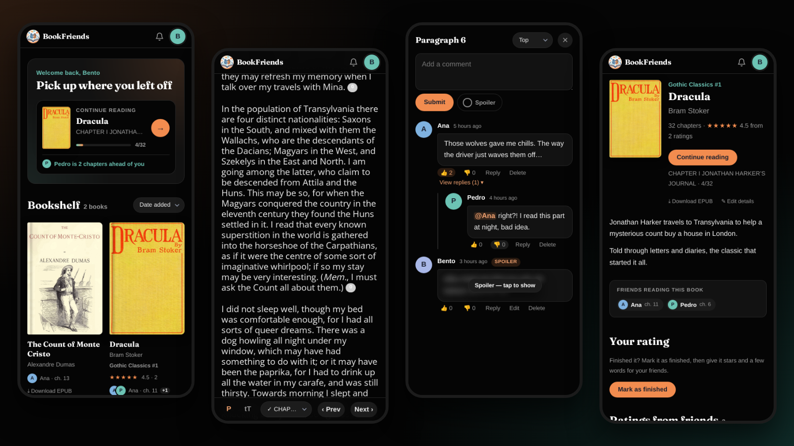
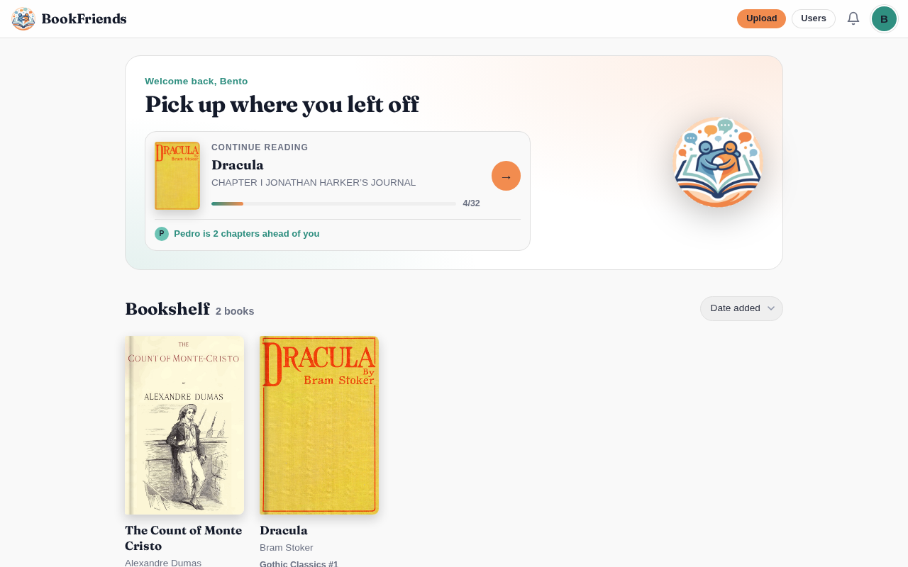

# BookFriends

**A little online library for friends: read the same books and talk about them right in the margins, paragraph by paragraph.**

Live at **[bookfriends.com.br](https://bookfriends.com.br)** · English · Português · Español



## What it does

**Reading**
- A Wuxiaworld-style reader for EPUB books: dark, light and sepia themes, six fonts, adjustable text size and line spacing.
- Your place is saved down to the paragraph. Swipe (or press ← →) to change chapters.
- Search inside a book, accent-insensitive ("joao" finds "João").
- Reads offline: the next chapters are saved on the phone automatically. Installable as an app.

**Together**
- Comments on any paragraph (a small count bubble after its last word) or on the whole chapter, with replies, likes, @mentions and a spoiler blur.
- Phone notifications when a friend replies to you or mentions you.
- See where each friend is in a book, on the shelf and in the reader.
- Finished books, 1–5 star ratings and reviews; reviews stay hidden until you finish the book yourself.
- Book requests with "me too" votes.

**For the owner**
- Upload EPUBs, keep books private or public, and edit a book's title, author, series, description and cover.
- Nightly backups, plus an off-site copy on a home Windows PC that one pasted command sets up. The Users page shows whether it's working, and GitHub emails you if the site goes down or the backups stop.

The site speaks English, Brazilian Portuguese and Spanish, picked from the browser's language and switchable at the bottom of every page.



## How it was built

BookFriends is the first project in a portfolio of AI-built software. Its owner isn't a programmer: every line was written by [Claude Code](https://claude.com/claude-code) from plain-language requests ("make the dark theme look like this screenshot", "the bar jumps when I scroll up on my phone").

- **Features in parallel.** Big batches were split across several AI agents, each working in its own git worktree, then merged and integrated.
- **Independent checks before every release.** A separate reviewer agent read the merged code, and an integration-test agent re-ran every feature's test suite against it. Between them they caught a denial-of-service in @mention parsing, notifications that silently switched themselves off, and a scroll-anchoring bug that moved readers' bookmarks.
- **Tested like a reader.** Changes are checked in headless Chrome (Playwright) at phone and desktop sizes, in dark and light themes and in Portuguese. Visual cleanups are proven by diffing every element's computed style before and after.

## Tech

Node.js and Express with server-rendered EJS pages; SQLite through better-sqlite3 (WAL, FTS5 full-text search); plain JavaScript in the browser with no build step; a service worker for offline reading and Web Push. Production runs on a free 1 GB Oracle Cloud VM behind Caddy.

```
server.js           app setup, middleware order, routers
src/                one folder per area: auth, books, comments, friends, requests, push, offline, backup, i18n, db
views/              EJS pages and partials
public/             reader.js (the reading page), push.js, sw.js, app.css, icons
test/               node --test suites (npm test)
scripts/backup.js   nightly backup
```

## Run it locally

```sh
cp .env.example .env   # set OWNER_EMAIL and SESSION_SECRET
npm install
npm start              # http://localhost:3000
```

Register with the exact `OWNER_EMAIL` address to get the owner account, then use **Upload** to add an `.epub`. New books start private; **Manage → Make public** on the shelf shares them.

```sh
npm test         # unit tests (EPUB parsing against the Dracula fixture, search, mentions, push, ...)
npm run lint
```

## Deploy on a small server

```sh
git clone <this repo> && cd bookfriends
cp .env.example .env            # OWNER_EMAIL, SESSION_SECRET, NODE_ENV=production
npm ci --omit=dev
node server.js                  # run it under systemd so it restarts and starts on boot
```

Put [Caddy](https://caddyserver.com) in front for automatic HTTPS:

```
example.com {
    reverse_proxy localhost:3000
}
```

To update: `git pull`, `npm install --omit=dev` when `package.json` changed, then restart the service.

## Google login (optional)

The login and register pages show **Continue with Google** when Google OAuth credentials are set; otherwise email and password work as usual.

1. In https://console.cloud.google.com, create (or pick) a project.
2. **APIs & Services → OAuth consent screen**: External, fill in the app name and your email, and publish it. The basic email and profile scopes need no Google verification.
3. **APIs & Services → Credentials → Create credentials → OAuth client ID**: type **Web application**, and under **Authorized redirect URIs** add `https://your-site.example/auth/google/callback` (plus `http://localhost:3000/auth/google/callback` for local testing).
4. Put both values in `.env` and restart:

   ```
   GOOGLE_CLIENT_ID=xxxxxxxx.apps.googleusercontent.com
   GOOGLE_CLIENT_SECRET=xxxxxxxx
   ```

Google accounts match site accounts by email, and the Google profile name becomes the first display name.

## Backups

`scripts/backup.js` writes a WAL-safe snapshot of the database (better-sqlite3's backup API) plus the book files and the push keys to `backups/bookfriends-YYYY-MM-DD.tar.gz`, keeping the newest 7. Schedule it nightly:

```cron
30 3 * * * cd /path/to/bookfriends && /usr/bin/node scripts/backup.js >> ~/backup.log 2>&1
```

**Off-site copy:** set `BACKUP_TOKEN` in `.env` to a long random string. Then:
- **On a Windows PC:** open the site's **Users** page there and follow the **Backups** box. It gives a ready-made PowerShell command that creates `C:\bookfriends-backups`, adds a nightly "BookFriends backup" task, and downloads the first copy right away.
- **Anywhere else:** download the newest archive with
  `curl -fsS -o bookfriends-$(date +%F).tar.gz "https://your-site/backup/download?token=..."`.

The Backups box shows when the off-site copy last arrived: OK under 36 hours, Warning up to 72, Problem after that. `/healthz` reports the same for the uptime checks in `.github/workflows/uptime.yml`; see [docs/MONITORING.md](docs/MONITORING.md).

**Restore:** stop the server, then `tar -xzf bookfriends-YYYY-MM-DD.tar.gz -C data`.

## Security notes

- **Register the owner account right after deploying.** The first registration with `OWNER_EMAIL` becomes the owner.
- Logins, sign-ups, password changes, comments, searches, book requests and backup downloads are rate-limited per IP (`src/rate-limit.js`).
- Book files are only served through access-checked `/media` routes, so private books stay private, and uploaded covers are checked by their bytes.
- Push endpoints must be a real push service, so users can't point the server at arbitrary hosts.
- If the service worker ever misbehaves, `SW_DISABLED=1` in `.env` makes every browser remove it on its next visit.
